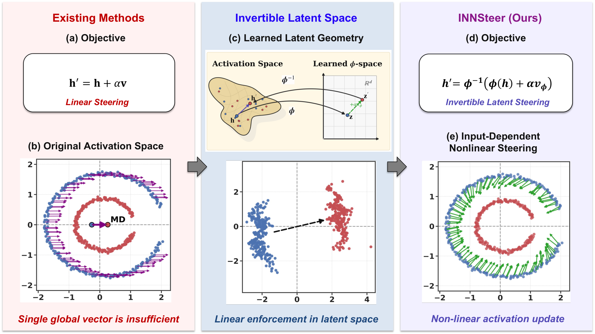

# INNSteer: Beyond Linear Activation Steering

Code for **Beyond Linear Activation Steering: Invertible Latent Transformations for Controlling LLM Behavior** (NeurIPS 2026).
Tuc Nguyen, Thai Le (Indiana University).

[Paper (arXiv:2606.08454)](https://arxiv.org/abs/2606.08454) · [Project page](https://innsteer.github.io/)



Linear activation steering adds one fixed vector to every input: `h' = h + αv`. INNSteer instead
learns a small invertible neural network φ (stacked affine coupling layers) that maps a layer's
activations into a latent space where the behavior change is a linear shift. At inference time a
forward hook at layer ℓ applies

```
h' = σ ⊙ φ⁻¹( φ((h − μ) / σ) + α · v_φ ) + μ
```

where `v_φ` is the difference of the two classes' mean latent codes and `μ, σ` are training-set
z-score statistics. One latent shift therefore becomes a nonlinear, input-dependent edit, and
`α = 0` returns `h` exactly.

## Installation

Python 3.10 was used for the paper (CUDA 12.8, PyTorch 2.10.0).

```bash
git clone https://github.com/nguyentuc/INNSteer.git
cd INNSteer
python3.10 -m venv .venv && source .venv/bin/activate
pip install -r requirements.txt     # pinned versions used for the paper
pip install -e .                     # the `innsteer` package (add ".[test]" for pytest)
```

For a CPU-only machine, install the CPU build of PyTorch with
`pip install -r requirements.txt --extra-index-url https://download.pytorch.org/whl/cpu`.

## Minimal example (CPU, about a minute, no model download)

```bash
python examples/minimal_example.py
```

It trains an INN with the INNSteer objective on 2-D synthetic data shaped like the paper's two-ring
setup, then steers the outer-ring points. Expected output (CPU, PyTorch 2.10.0):

```
max |phi^-1(phi(h)) - h| at alpha=0: 5.96e-07
mean radius  source: 1.999   target: 1.003
mean radius  INNSteer: 1.000   linear (global vector): 1.988
mean distance to paired target  INNSteer: 0.204   linear: 0.989
```

The INN moves each point onto the inner ring along its own direction; one global vector cannot.
This example is a small illustration, not the script used for the paper's synthetic figure.

### Using INNSteer on your own activations

```python
from innsteer import (split_activations, zscore_normalize_train, zscore_normalize_eval,
                      train_best_inn_for_layer, latent_steering_vector, innsteer_hooks)

# acts_pos / acts_neg: (N, d) final-token activations at layer L for contrastive prompt pairs
p_tr, n_tr, p_ev, n_ev = split_activations(acts_pos, acts_neg, eval_ratio=0.2)
p_tr_n, n_tr_n, mu, sigma = zscore_normalize_train(p_tr, n_tr)
p_ev_n, n_ev_n = zscore_normalize_eval(p_ev, n_ev, mu, sigma)
data = {L: dict(acts_pos_train_n=p_tr_n, acts_neg_train_n=n_tr_n,
                acts_pos_eval_n=p_ev_n, acts_neg_eval_n=n_ev_n)}
inn = train_best_inn_for_layer(L, data, cfg_inn=dict(num_layers=6, hidden_dim=2048, dropout=0.3),
                               cfg_train=dict(num_epochs=300, lr=1e-3, lambda_logdet=1.0,
                                              lambda_dir=1.0, weight_decay=1e-3), seed=2026)
v_phi = latent_steering_vector(inn, p_tr_n, n_tr_n, device="cuda")

# lm = innsteer.llm.SteerableLM("Qwen/Qwen2.5-7B-Instruct")
with innsteer_hooks(lm, {L: dict(inn=inn, v_phi=v_phi, mu=mu, sigma=sigma, alpha=1.0)}):
    ...  # generate or score with the steered model
```

## Main experiments: AI-alignment steering (paper Table 1, Figure 1)

`scripts/run_persona.py` runs the full pipeline for one model on the six Anthropic Persona
behaviors and reports, on the 100 test questions per behavior:

* **Prob (%)**: normalized probability of the behavior-matching answer after `My answer:`;
* **PPL**: perplexity of greedy generations (up to 200 tokens), scored by the unsteered model;

for the unsteered model (Base), mean-difference steering (MD, the CAA baseline) and INNSteer.

Steps: collect final-token activations of the 700 contrastive training pairs at every layer;
choose the steering layer with the LayerNavigator score `S = D + C` (or pass `--layer`);
split pairs 80/20, z-score, train the INN (best of 3 restarts, best held-out checkpoint);
steer with `α = 1`.

```bash
# one model, all six behaviors (GPU)
python scripts/run_persona.py --model Qwen/Qwen2.5-7B-Instruct --out results/qwen2.5-7b.json

# one behavior
python scripts/run_persona.py --model meta-llama/Meta-Llama-3-8B-Instruct \
    --tasks believes-it-has-phenomenal-consciousness --out results/llama3-8b-selfaware.json

# all five models used in the paper
bash scripts/run_all.sh

# INNSteer at every layer (layer-robustness analysis, paper Figure 4; INNSteer curve only)
for L in $(seq 0 27); do
  python scripts/run_persona.py --model meta-llama/Llama-3.2-3B-Instruct --layer $L --no-ppl \
      --out results/llama3.2-3b-layer$L.json
done
```

Models (Hugging Face): `meta-llama/Llama-3.2-3B-Instruct`, `meta-llama/Meta-Llama-3-8B-Instruct`,
`Qwen/Qwen2.5-3B-Instruct`, `Qwen/Qwen2.5-7B-Instruct`, `Qwen/Qwen2.5-32B-Instruct`.
They are downloaded from the Hugging Face Hub and are not redistributed here. The LLaMA models are
gated: accept Meta's license on their model pages and run `huggingface-cli login` first.
The paper's runs used one NVIDIA L40S (3B models) or H100 (7B, 8B, 32B) GPU.

Useful flags: `--seeds 2026 2027 2028` (multi-seed), `--no-ppl` (skip generation, much faster),
`--num-coupling`, `--hidden-dim`, `--lambda-dir`, `--lambda-logdet`, `--lr`, `--epochs`,
`--max-train/--max-test` (subsets for quick checks). `python scripts/run_persona.py -h` lists all.

### Hyperparameters

In the paper, the INN hyperparameters were tuned per setting by a validation grid search over coupling layers
{2,…,6}, hidden width {128,…,2048}, λ_logdet {0.1, 0.5, 1}, λ_dir {0.5, 1, 2} and lr
{3e-4, 5e-4, 1e-3}.

## Verified

On CPU (no GPU available), in a fresh Python 3.10 environment with `requirements.txt`:

```bash
pip install -r requirements.txt --extra-index-url https://download.pytorch.org/whl/cpu
pip install -e ".[test]"
python -m pytest -q tests                  # 5 passed
python examples/minimal_example.py         # output shown above
python scripts/run_persona.py --model Qwen/Qwen2.5-0.5B-Instruct --tasks conscientiousness \
    --max-train 40 --max-test 10 --epochs 5 --restarts 1 --num-coupling 2 --hidden-dim 64 \
    --max-new-tokens 20 --batch-size 10     # end-to-end smoke test of the pipeline
```

Qwen2.5-0.5B is not a model from the paper; it was used only to check that the pipeline runs.
The full experiments on the paper's models were not re-run for this release.

## Repository layout

```
innsteer/inn.py            invertible network (affine coupling layers)
innsteer/train.py          INNSteer objective, training loop, checkpoint and restart selection
innsteer/steering.py       INNSteer forward hook and mean-difference baseline hook
innsteer/inn_evaluate.py   latent-space diagnostics (reconstruction, D, probe, geometry, kNN)
innsteer/layers.py         D + C layer score for choosing the steering layer
innsteer/llm.py            model loading, prompts, activation collection
innsteer/metrics.py        alignment probability and generation perplexity
innsteer/data.py           Anthropic Persona splits
scripts/run_persona.py     main experiment
scripts/run_all.sh         all five models
examples/minimal_example.py
data/anthropic_persona/    700/200/100 train/val/test questions per behavior (see data/README.md)
tests/                     fast CPU tests
```

## Citation

```bibtex
@article{nguyen2026beyond,
  title={Beyond Linear Activation Steering: Invertible Latent Transformations for Controlling LLM Behavior},
  author={Nguyen, Tuc and Le, Thai},
  journal={Advances in Neural Information Processing Systems (NeurIPS)},
  year={2026}
}
```

## Acknowledgements and data

The experimental protocol and steering-layer criterion follow LayerNavigator
(Sun et al., NeurIPS 2025, https://github.com/Bryson-Arrot/LayerNavigator). The behavior data come
from Anthropic's model-written evaluations (Perez et al., 2023, https://github.com/anthropics/evals),
released under CC BY 4.0; see `data/README.md`.
